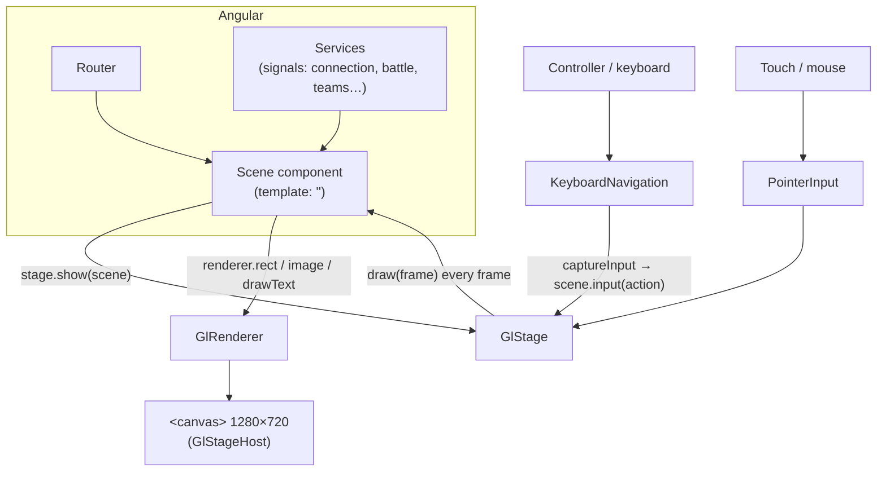

# Architecture

This is the map of the app: how a frame gets on screen, where state lives and how the code is laid
out. Read it first; the other guides go deeper into each part.

## The big idea: one canvas, Angular as the skeleton

The app runs on the **Nintendo Switch** as a homebrew `.nro` on the nx.js engine
([native.md](native.md)): a 1280×720 screen and a controller, and no HTML/CSS layout at all, so the
app doesn't use the DOM for UI. The whole UI is drawn with WebGL on **one 1280×720 canvas**:

- **`GlStage`** (`src/app/core/gl/gl-stage.ts`) owns the renderer, the text and image caches and the
  frame loop.
- **`GlStageHost`** (`gl-stage-host.ts`) is the only visible element in the page. It sizes the canvas
  to the screen (1920×1080 when the console is docked) while scenes keep drawing a 1280×720 stage.
- **Angular is the skeleton only**: dependency injection, services, signals and the router. Every
  route is a *scene component* with an empty template that draws itself on the stage every frame.



There are no HTML controls, no CSS for UI and no ARIA. This was a deliberate choice: a canvas is
invisible to assistive technology, so accessibility here means WCAG AA contrast in every theme and a
UI fully usable with the controller alone. See [ui-kit.md](ui-kit.md).

## Life of a frame

1. `GlStage` runs one `requestAnimationFrame` loop while at least one scene is shown.
2. Each frame it calls `draw(frame)` on the **top scene** only. `frame` (`StageFrame`) carries the
   shared resources (`renderer`, `text`, `images`, `disc`), `now` (ms) and `dt` (seconds, at most 0.1).
3. The scene starts the frame itself (`renderer.begin(...)` for the animated backdrop or
   `renderer.beginPlain(color)`), draws everything, declares its focusable controls to its
   `CanvasFocus`, and ends with `renderer.end()`.
4. An **overlay** (the on-screen keyboard, `GlStage.setOverlay`) draws over the scene and gets input
   first.
5. With **L3** pressed, the performance HUD (`PerfHud`) draws on top: frame times, draw calls, cache
   use and the scene's own `diagnostics()` lines.

Scenes draw in **immediate mode**: nothing is retained between frames except the scene's own state.
That keeps screens simple (draw what the state says) and the renderer batches the quads, so redrawing
everything every frame is cheap. See [rendering.md](rendering.md) for the caches and the budgets that
keep it at 60 fps on the console.

## A scene

A scene is a component with an empty template. In its constructor it shows itself on the stage and
takes itself away when destroyed:

```ts
@Component({ selector: 'app-settings-scene', template: '' })
export class SettingsScene {
  private readonly stage = inject(GlStage);
  private readonly focus = new CanvasFocus();

  constructor() {
    const hide = this.stage.show({
      draw: (frame) => this.draw(frame),
      input: (action) => this.onAction(action),
      click: (x, y) => this.focus.click(x, y),
      hover: (x, y) => this.focus.hover(x, y),
    });
    inject(DestroyRef).onDestroy(hide);
  }
}
```

The `GlScene` interface (`gl-stage.ts`) is all a scene implements: `draw`, and optionally `input`,
`click`, `hover` and `diagnostics`. Resources the scene creates (its own textures) are made in
`stage.whenReady(...)` and deleted on destroy. The stage's caches outlive scenes, so the next screen
finds sprites and texts already uploaded.

[ui-kit.md](ui-kit.md) walks through building a complete screen.

## State

- **Signals everywhere.** Services expose `signal`s and `computed`s; scenes read them inside `draw`.
  Because the canvas redraws every frame, a scene doesn't need change detection to see new state:
  reading the signal in `draw` is enough.
- **Drawing state stays outside signals.** Animation progress, scroll offsets and focus are plain
  fields on the scene (they change every frame, and nothing else needs to react to them).
- **`RenderScheduler`** forces an Angular tick after state changes from outside Angular events
  (WebSocket messages, timers). On the console, Angular's own scheduling sometimes never ran.
- **Persistence** goes through `core/persistence/device-storage.ts` (`readJson` / `writeJson`). On the
  console each key is a JSON file on the SD card (`sdmc:/switch/pokemon-showdown-nx/`), which always
  survives (the engine's `localStorage` doesn't, on the very first launch). In a browser it's
  `localStorage`.
- **Settings** (theme, volumes, default formats…) live in `AppSettings` (`core/settings`).

## Code layout

```
src/
  main.ts, index.html, styles.css    bootstrap; styles.css only lays out the stage
  app/
    app.ts                           root: GlStageHost + router outlet; starts app-wide services
    app.routes.ts                    one lazy-loaded scene per route
    core/                            app-wide infrastructure, no feature logic
      gl/                            GlStage, GlRenderer, text/image caches, sprites, pointer input
        ui/                          the canvas UI kit (retro-kit, PageBar, pickers, keyboard, themes)
      input/                         controller and keyboard (KeyboardNavigation, console-keys)
      audio/                         Web Audio: UI sounds, menu theme, battle music
      dex/                           bundled game data (JSON) and its typed accessors
      persistence/                   device-storage (SD card on the console, localStorage elsewhere)
      settings/                      AppSettings
      runtime/                       RenderScheduler
    features/                        one folder per area of the app
      <feature>/
        components/<name>-scene/     the route's scene component
        gl/                          the feature's canvas views (drawn by the scene)
        state/                       signal-based services and pure state logic
        data/                        HTTP clients, parsers, storage for the feature
        models/                      types
    shared/                          code used by several features (formats, type colours, utils)
native/                              the .nro's entry and engine shims (app/) and console probes (poc/)
scripts/                             the .nro build and game-data update scripts
public/                              static assets copied as-is (sprite sheets, audio, icons)
```

Path aliases: `@core/*`, `@features/*` and `@shared/*` (see `tsconfig.json`).

### Routes

| Route | Scene | What it is |
| --- | --- | --- |
| `/` | `HomeScene` | Home menu. A launch goes through `/loading` first |
| `/loading` | `LoadingScene` | Preloads sprite sheets, sounds, battle music and the keyboard's texts |
| `/play` | `PlayScene` | Battle lobby: format, team, ladder search, challenges |
| `/battle` | `BattleScreen` | Battle (playing, spectating or a replay). Can't be left mid-battle |
| `/teambuilder` | `TeambuilderScene` | Teams, Pokémon editor, damage calc |
| `/live` | `LiveScene` | Battles being played now |
| `/replays` | `ReplaysScene` | Replay search |
| `/history` | `HistoryScene` | The player's own battles |
| `/chats` | `ChatsScene` | Chat rooms |
| `/settings` | `SettingsScene` | Settings |
| `/gl-kit` | `GlKitScreen` | Developer showcase of the UI kit (R3 on the home menu) |

The router uses hash URLs (`withHashLocation`): on the console the location only lives in memory
(`native/app/dom-shim.ts`).

### App-wide services

`App` (`app.ts`) starts the services that must run on every screen: incoming challenges, saved login,
the server's format list, replay auto-save, and opening a battle when a challenge is accepted.

## Talking to Showdown

The app is a client of the official Pokémon Showdown server (`wss://sim3.psim.us`). Everything about
the connection lives in `features/connection` (WebSocket, login, challenges, ladder search, battle
rooms); the battle protocol is parsed in `features/battle/state`. See [showdown.md](showdown.md).

## Building for the console

`npm run build:nro` runs `ng build`, then `scripts/build-nro.mjs` bundles Angular's output after the
engine shims in `native/app` and packages it, with the assets, as the Switch app. See
[native.md](native.md) for the engine's limits and how to test on the console.
