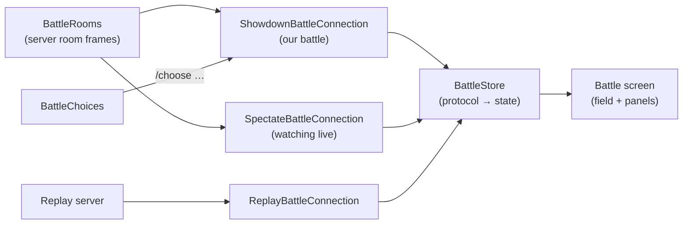

# Talking to Pokémon Showdown

The app is a client of the official Pokémon Showdown server. It doesn't simulate battles itself: the
server runs them, and the app sends commands and draws what the server tells it. This guide covers
the connection, logging in, finding battles and the battle protocol.

The server's protocol is documented in Showdown's repository:
[PROTOCOL.md](https://github.com/smogon/pokemon-showdown/blob/master/PROTOCOL.md) and
[SIM-PROTOCOL.md](https://github.com/smogon/pokemon-showdown/blob/master/sim/SIM-PROTOCOL.md). When
you're unsure how the server behaves, check it live and note what you found in the code's comments,
as the existing code does.

## Endpoints

| Endpoint | Used for | Where |
| --- | --- | --- |
| `wss://sim3.psim.us/showdown/websocket` | The game server: rooms, battles, chat, commands | `ShowdownConnection` |
| `https://play.pokemonshowdown.com/api/…` | Login server: guest and registered names, registration | `ShowdownLogin` |
| `https://play.pokemonshowdown.com/…` | Sprites, item icons, cries, trainer avatars | `GlSprites`, `BattleCries` |
| `https://replay.pokemonshowdown.com` | Replay search and logs | `features/replays/data/replay-api.ts` |
| `https://pokepast.es` | Importing teams from PokePaste | `features/teambuilder/data` |

Every origin must be on the Brewser allow-list ([brewser.md](brewser.md#network)).

## The connection

`ShowdownConnection` (`features/connection/showdown-connection.ts`) is the app's **single WebSocket**.

- **Nothing connects on launch.** The player connects from the home screen (as a guest or with a
  name), unless Settings asks to log in automatically. Some features connect on their own and close
  the connection again if nothing else uses it (team validation).
- Every server message is parsed into a **frame**, a room id plus its protocol lines
  (`showdown-protocol.ts`). Features subscribe to `connection.frames` and keep the rooms they care
  about.
- `send(roomId, text)` sends a command or a chat line to a room (`''` for the global room).
- `state()` is a signal: `status` (`offline`, `connecting`, `connected`, `reconnecting`) and `trouble`
  (`no-network`, or Showdown out of reach).
- **Drops are detected and recovered**: an attempt that never opens times out, an open connection
  that goes quiet gets a heartbeat, and reconnections back off from 1 s to 15 s. That's short enough
  to get back into a battle within the minute Showdown waits for a player who dropped.

`connection-notice.ts` turns that state into the text the UI shows ("Reconnecting in 4 s…").

## Names and login

`ShowdownLogin` gives the player a name on the server.

1. On connecting, the server sends `|challstr|`.
2. **Guest**: the app asks the login server for an assertion for a random unregistered name and claims
   it with `/trn name,0,assertion`. A taken name moves on to another; `newName()` picks a new one.
3. **Registered**: `logIn(name, password)` gets the assertion with the password. `register(...)`
   registers a new name.
4. After a drop, the same name is **claimed again** on the new connection (`reclaiming`), retrying
   for a minute while the server still holds it for the old one. The server puts a player back in
   their battles by name.

`SavedLogin` keeps what Settings allows: the name ("Remember my name") and, only on the console's SD
card and only while "Log in automatically" is on, a registered name's password.

The login server only allows CORS from Showdown's own site, so in a desktop browser logging in needs
web security disabled ([brewser.md](brewser.md#developing-in-a-desktop-browser)). The console doesn't
enforce CORS.

## Finding a battle

| Service | What it does | Commands |
| --- | --- | --- |
| `ShowdownSearch` | Ladder search | `/utm <packed team>` (or `/utm null`), `/search <format>`, `/cancelsearch`; the server answers with `\|updatesearch\|` |
| `ShowdownChallenges` | Challenges sent and received, accepted or rejected (with a team) | `/challenge`, `/accept`, `/reject`, `/cancelchallenge` (with `/utm` for the team); challenges arrive as `\|pm\|` lines carrying `/challenge` |
| `BattleRooms` | The battle rooms the server puts us in, and rooms joined to watch | `/join`, `/leave`, battle commands |

Before a search or a challenge, the app sends whether the next battle allows spectators
(`/inviteonlynext`, see `showdown-protocol.ts`).

When a match is found or a challenge accepted, the server opens a battle room. `BattleRooms` keeps
its first frames (they arrive while the battle page is still loading), and `App` (`app.ts`) opens
`/battle` once the room has something to show.

Other services in `features/connection`:

- `ShowdownFormats`: the format names the server lists on connecting (`|formats|`).
- `ServerStats`: players online and battles running (`/cmd rooms`), only while a screen shows them.
- `ReplayAutoSave`: sends `/savereplay` when each of the player's battles ends, so the battle history
  can find it.

Server refusals usually come as `|popup|` messages; the services match them to the action that caused
them by timing (see the constants at the top of each service).

## Battles

All three kinds of battle go through the same code: a **`BattleConnection`**
(`features/battle/models/battle.ts`) feeds protocol frames to the **`BattleStore`**, and the screen
draws the store's state.

| Connection | Source | Notes |
| --- | --- | --- |
| `ShowdownBattleConnection` | A room we play in | Sends choices as `/choose <choice>\|<rqid>`. Swaps sides when we're p2, so we're always at the bottom (`side-swap.ts`) |
| `SpectateBattleConnection` | A room joined to watch | The first frame is the whole battle so far; no choices |
| `ReplayBattleConnection` | A saved replay's log | Same protocol a spectator gets; the store paces playback (pause, speed, skip turn) |

`BattleSession` tells the `/battle` route what to open (`requestLive`, `requestSpectate`) and keeps
the player from leaving while a battle is open. It's kept apart from `BattleStore` so the battle code
only loads with the battle page.

### `BattleStore`

`features/battle/state/battle-store.ts` turns protocol lines into state:

- Log lines **play back one step at a time**: each step updates the field, adds its battle log entry
  and waits, so animations and messages have time to show. The server's `|request|` is held until the
  log leading up to it has played.
- When returning to a battle already past turn 1 (the app was closed mid-battle), the log so far is
  applied at once instead of played again.
- Field events (`FieldEvent`: hits, faints, switches, Mega Evolution, protection…) and popups
  (abilities, items) are what the field animates.
- The battle timer, team preview, open team sheets and Best-of-3 series have their own state files
  next to it (`battle-series.ts`, `team-preview.ts`, `team-sheet.ts`).

### Making choices

`BattleChoices` builds the turn's choice one active slot at a time from the store's request (a move
and its target, or a switch, plus Mega Evolution or Terastallization) and sends the whole choice
string ("move 1 2 mega, switch 3"). `back()` undoes a step. It's a root service, so a half-made choice
survives a visit to another page.

## Other server features

| Feature | Where | How |
| --- | --- | --- |
| Team validation | `teambuilder/state/team-validation.ts` | `/utm <packed team>` then `/vtm <format>`; the answer is a `\|popup\|` |
| Watch Live | `live/state/live-battles.ts` | The server's battle list for a format (`/cmd roomlist`) |
| Player ratings | `live/state/player-ratings.ts` | Showdown's ladder API (`/api/ladderget`, no CORS in a desktop browser) |
| Replays and history | `replays/data/replay-api.ts` | The replay server's search and log endpoints |
| Chat rooms | `lobby/state/chat-room-store.ts`, `lobby/data/chat-rooms.ts` | `/join`, `/leave`, chat lines; one room at a time. Server HTML (`\|raw\|`, `\|uhtml\|`) is never rendered |

## Packed teams

Showdown sends and receives teams in its **packed** format (one line, `|` and `]` separated). The
teambuilder converts its teams with `features/teambuilder/data/packed-team.ts`. Random formats send
no team (`/utm null`).

## Tips for working on this

- Log the raw frames while developing (subscribe to `connection.frames`), and compare with what
  Showdown's own client does (open its browser console and watch the WebSocket).
- Messages arrive outside Angular events. Services update signals and call
  `RenderScheduler.request()` where Angular-side views need to refresh; canvas scenes pick up the new
  state on their next frame anyway.
- Be gentle with the official server: no polling loops faster than the existing ones, and no
  automated testing against it.
